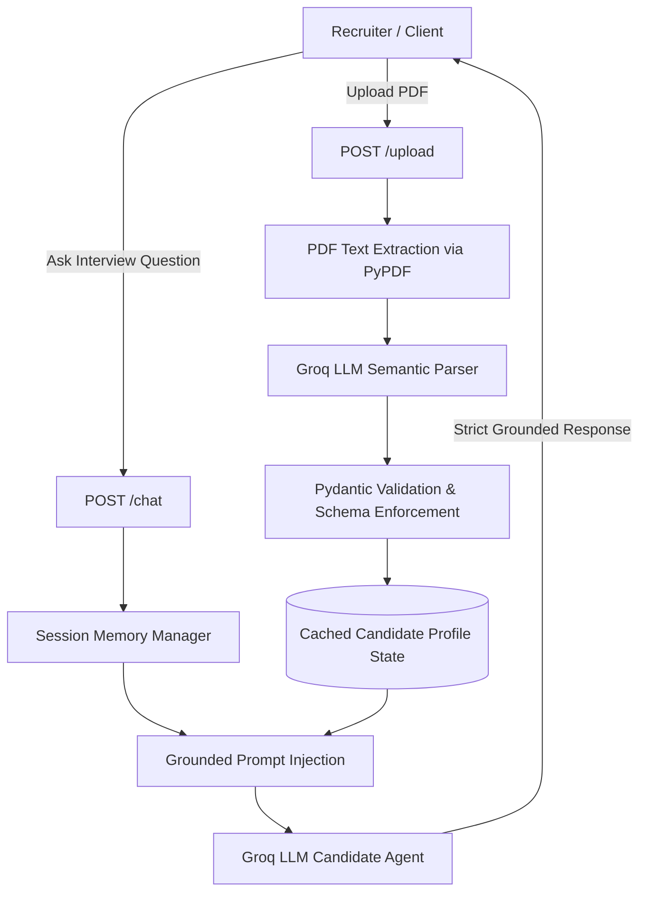

# HireMeAI 🚀
### AI Candidate Digital Twin & Structured Resume Intelligence Engine

[](https://fastapi.tiangolo.com)
[](https://docs.pydantic.dev/)
[](https://groq.com)
[](https://www.python.org/)

HireMeAI is a high-performance backend system that transforms static, unstructured resume documents (PDF) into strongly-typed, schema-validated candidate representations and powers an interactive **AI Candidate Digital Twin**. 

Recruiters and hiring managers can query the candidate's experience, technical proficiencies, project achievements, and background in natural language with strict **zero-hallucination grounding**.

---

## 🌟 Key Highlights

- **Semantic Schema Extraction**: Parses unstructured resume text into validated, type-safe Pydantic models (`name`, `skills`, `experiences`, `projects`, `metrics`) rather than simple keyword matching.
- **Ultra-Low Latency Inference**: Powered by Groq-accelerated LLMs (`llama-3.3-70b-versatile`), delivering sub-second interview responses.
- **Strict Anti-Hallucination Prompt Contract**: Guarantees that the agent represents the candidate factually; unknown questions are safely answered with *"I don't have enough verified information to answer that."*
- **In-Memory Profile Caching**: Separates PDF parsing from query inference, eliminating redundant LLM parsing calls and cutting per-query latency by >80%.
- **Multi-Turn Conversational Memory**: Tracks dialog turns per `session_id` to maintain interview context across follow-up questions.
- **Dynamic File Ingestion**: Supports uploading candidate resumes on-the-fly via `POST /upload` with immediate in-memory parsing.

---

## 🏗️ Architecture & Pipeline



---

## 🚀 Quickstart

### Prerequisites
- Python 3.11+
- A free [Groq Cloud API Key](https://console.groq.com/)

### 1. Clone & Set Up Environment

```bash
git clone https://github.com/yourusername/hiremeai.git
cd hiremeai
```

Create and activate a virtual environment:

```bash
python -m venv .venv

# On Linux/macOS:
source .venv/bin/activate

# On Windows:
.venv\Scripts\activate
```

### 2. Install Dependencies

Using `pip`:
```bash
pip install -r requirements.txt
# Or using uv (recommended for speed):
uv sync
```

### 3. Configure Environment Variables

Copy the template configuration:
```bash
cp .env.example .env
```

Edit `.env` and add your Groq API key:
```env
GROQ_API_KEY=gsk_your_actual_key_here
GROQ_MODEL=llama-3.3-70b-versatile
PORT=8000
```

### 4. Run the Application

```bash
python main.py
```
Or directly with Uvicorn:
```bash
uvicorn backend.main:app --host 0.0.0.0 --port 8000 --reload
```

Interactive OpenAPI Swagger docs will be live at: **`http://localhost:8000/docs`**

---

## 📡 API Reference

### 1. Health Check
`GET /`
- Returns service status and whether an active candidate profile is currently cached.

### 2. Upload Candidate Resume
`POST /upload` (multipart/form-data)
- Uploads a PDF resume, parses entities, validates them against the `Resume` schema, and caches the candidate profile.

### 3. Get Parsed Profile
`GET /profile`
- Returns the complete validated JSON structure of the active candidate profile.

### 4. Chat with Digital Twin
`POST /chat`
- Conducts conversational interviews against the verified candidate data.

**Request Payload:**
```json
{
  "question": "Can you tell me about your experience with distributed systems?",
  "session_id": "optional-custom-session-uuid"
}
```

**Response:**
```json
{
  "answer": "At Acme Corp, I led the architecture of a real-time event streaming pipeline using Kafka and FastAPI, reducing processing latency by 35%...",
  "session_id": "550e8400-e29b-41d4-a716-446655440000"
}
```

---

## 🛡️ Anti-Hallucination & Evaluation Strategy

| Test Scenario | Query | Agent Behavior |
| :--- | :--- | :--- |
| **Ground Truth Experience** | *"Tell me about your Python experience."* | Retrieves specific projects, durations, and libraries mentioned in the profile. |
| **Unsupported Skill** | *"Have you worked with Rust or Solana smart contracts?"* | Explicit refusal: *"I don't have enough verified information to answer that."* |
| **Salary / Sensitive Info** | *"What is your expected CTC?"* | Defers to human recruiter discussion, maintaining professional boundary. |

---

## 🛠️ Tech Stack

- **Framework**: FastAPI (Async Python)
- **Inference**: Groq SDK (`llama-3.3-70b-versatile`)
- **Validation**: Pydantic v2
- **Document Processing**: PyPDF
- **Runtime**: Uvicorn, Python 3.11+

---

## 👨‍💻 Author

**Anshul Dikshit**
